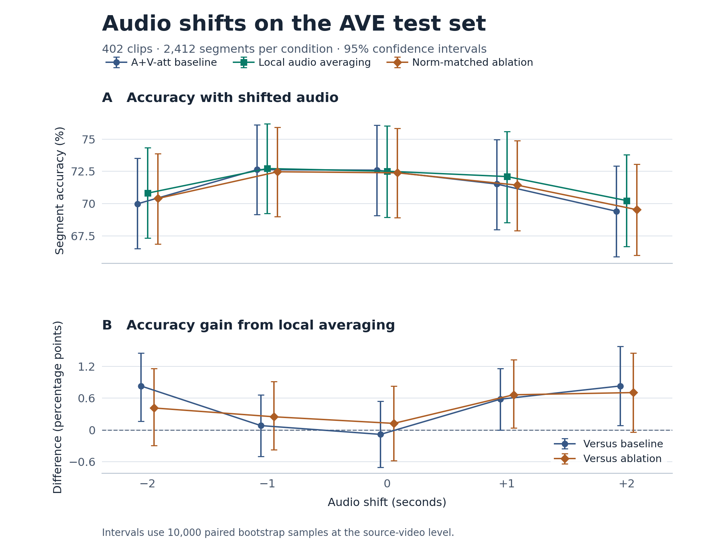

# Temporal audio shifts on AVE

Eren Kahraman · Yildiz Technical University · YZM5110 Multimodal Learning · 2026

This project shifts audio relative to video by 0, ±1 and ±2 seconds in Tian et al.'s published A+V-att model. Each offset is paired with an unshifted control receiving the same boundary mask. Local audio averaging is the single intervention. A norm-matched ablation helps distinguish the contribution of neighboring feature directions from changes in magnitude.

## Submission files

- [Research report in English](output/pdf/Kahraman_YZM5110_Research.pdf)
- [Editable presentation in English](output/slides/Kahraman_YZM5110_Presentation.pptx)
- [Five-paper comparison and synthesis](MAKALE-KARSILASTIRMA.md)
- [Test results, confidence intervals and failure analysis](results/ave_test_report.md)
- [AI assistance disclosure](AI_USAGE.md) and [third-party components](THIRD_PARTY.md)

## Measured results

On 402 original test clips, all shift conditions score the same six central seconds. Mean shifted accuracy at ±2 seconds is 69.69% for the baseline, 70.52% for local averaging and 69.96% for the norm-matched ablation. Local averaging gains 0.83 percentage points over the baseline (95% CI [0.29, 1.35]). The matched shift penalty D₂ is 1.89 points for the baseline and 1.31 for local averaging. The interval for the reduction in D₂ includes zero. The unmasked full-clip reproduction is 72.7363%, compared with the paper's published 72.7%.

## Setup

The tested environment is Python 3.12.14 on a macOS arm64 CPU. Git and network access are required. Package versions are pinned in requirements.txt. Use Python 3.12 on a platform supported by these packages.

~~~bash
python3.12 -m venv .ave-local/venv
.ave-local/venv/bin/python -m pip install -r requirements-figures.txt
~~~

Use requirements.txt when figure generation is unnecessary. To rebuild the English report, install the additional report packages.

~~~bash
.ave-local/venv/bin/python -m pip install -r requirements-report.txt
.ave-local/venv/bin/python -B scripts/build_report.py --repo-url https://github.com/yasarkasa/yzm5110-ave-audio-shifts --published
~~~

## Data and checkpoint access

The preparation script pins the authors' repository to revision 93f843fed72fb17394df76330df958b0c2dbde76. Labels, split lists and weights are read from that checkout. Visual features are downloaded from the authors' link through verified HTTP byte ranges. Audio comes from the LECOO/AVE mirror and is checked against the recorded SHA-256. Assets are stored under .ave-local/.

The official audio link returned a quota error. Full identity of the mirror to the original audio file remains unverified. Experiments use precomputed features and checkpoint inference. Raw feature extraction and retraining are outside the evaluated scope. Source links and access conditions are documented in [THIRD_PARTY.md](THIRD_PARTY.md). Course PDFs, feature files, the local environment, large checkpoints and credentials are excluded from Git.

## Small execution check

The small check verifies features, labels and model outputs on three validation clips. Initial access downloads about 42.4 MB of audio features, 6 MB of visual features and the upstream repository. Access depends on Google Drive and Hugging Face availability. Quota or range errors stop the command. Completed visual rows are retained for retries.

~~~bash
.ave-local/venv/bin/python -B scripts/prepare_ave.py --split smoke
.ave-local/venv/bin/python -B scripts/ave_smoke.py
~~~

## Reproduce the reported experiments

Visual rows require about 807 MB each for the test and validation splits, or 1.61 GB combined. The installed environment and PyTorch require additional disk space. Download time depends on network availability and quotas. Once cached, inference runs on CPU.

~~~bash
# Prepare the selected visual feature rows
.ave-local/venv/bin/python -B scripts/prepare_ave.py --split all

# Reproduce the paper's unmasked full-clip A+V-att result
.ave-local/venv/bin/python -B scripts/ave_reference.py

# Check five offsets and their matched controls on validation
.ave-local/venv/bin/python -B scripts/ave_shift.py

# Evaluate the fixed intervention and ablation on validation
.ave-local/venv/bin/python -B scripts/ave_improvement.py

# Run the original test, bootstrap, latency and failure analysis
.ave-local/venv/bin/python -B scripts/ave_test.py

# Rebuild tables and the figure from the saved test JSON
.ave-local/venv/bin/python -B scripts/export_tables.py
.ave-local/venv/bin/python -B scripts/plot_ave_test.py
~~~

The test script checks method and configuration hashes against the recorded validation run and stops on a mismatch. Latency varies with machine load. Bootstrap uses seed 2026 and resamples source video IDs jointly across methods and offsets. All 402 test clips have distinct source IDs. A sensitivity analysis excludes eight IDs also present in training or validation, leaving 394 clips.

Saved JSON and CSV results are tracked in Git. The final two commands rebuild tables and the figure without downloading AVE features. These commands update their corresponding outputs under results/. Use a separate checkout to preserve a submitted snapshot.

## Configuration and submitted revision

[configs/ave_improvement.json](configs/ave_improvement.json) records the two-second radius, neighbor weight 0.5, scored indices 2-7, accuracy batch size 16 and single-clip latency protocol fixed before the test. Model weights remain those of the authors' checkpoint. The configuration SHA-256 is 5adb3bbca7243ed4d56d9ab1488811b69b522e6bb8b12246a24f08a568d8b846.

The English submission is pinned by the commit linked in the project handoff and available in GitHub history. A GitHub Release is optional. Local tags from the preceding Turkish draft are historical candidates and do not identify the English submission.

Experiments from 9-10 November were packaged on 11 November. Separate commits were not recorded during those runs. The [project log in Turkish](ARASTIRMA-PLANI.md) preserves the original stage records. The local course-material index also remains in Turkish as a working reference.

## Attribution and AI disclosure

The main source is Tian et al. (ECCV 2018), *Audio-Visual Event Localization in Unconstrained Videos*. [Paper](https://arxiv.org/abs/1803.08842) · [Authors' code](https://github.com/YapengTian/AVE-ECCV18)

OpenAI Codex assisted with literature search, implementation adaptation, experiment execution, analysis and report/presentation editing. The method and control design were also developed with Codex suggestions during the conversation. Specific contributions are documented in [AI_USAGE.md](AI_USAGE.md). The student remains responsible for reading sources, understanding the implementation, verifying claims and defending the conclusions.
